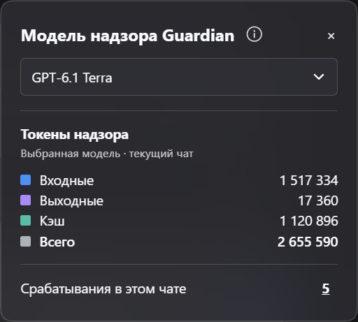

# Guardian для DeepSeek Harness

Guardian — дополнительная проверка действий агента в DSH Desktop и Web. Вы выбираете модель надзора отдельно от модели чата. Перед вызовом инструмента Guardian может пропустить действие, запросить подтверждение или заблокировать его. После ответа агента он также может оставить замечание о ходе работы. Guardian не заменяет разрешения DSH и не гарантирует обнаружение всех рисков.

## Как включить

1. Откройте чат. В DSH `0.2.2-rc.3` щит **G** появляется под полем ввода после создания сессии. Чтобы проверить первую рабочую команду, сначала отправьте приветствие.
2. Нажмите щит и выберите модель из доступных в DSH. Включите соседний переключатель: зелёный означает «включён», красный — «выключен». Настройки текущего чата сохраняются после перезапуска.
3. Чтобы использовать такую настройку для **новых** чатов, откройте **Плагины → Установленные → Guardian**, выберите модель по умолчанию, отметьте «Включать надзор в новых чатах» и нажмите **Сохранить**. Уже созданные чаты не изменятся. Изначально надзор выключен.



## Как проверить срабатывание

В панели щита нажмите число рядом с **«Срабатывания в этом чате»**. В истории показаны предупреждения, запросы подтверждения и блокировки для всех моделей этого чата. Обычные проверки без вмешательства сюда не попадают. Нажмите **«К сообщению →»**: Guardian раскроет нужные блоки и пометит выбранное событие полосой со щитом. У записи без привязанного сообщения переход недоступен.

[Все пять снимков интерфейса с пояснениями](docs/Интерфейс.md).

## Данные, расход и ограничения

- Включённый Guardian делает дополнительные запросы к выбранному провайдеру через авторизацию и квоту DSH. Он получает видимые сообщения, сведения о рабочей папке, недавние результаты инструментов и аргументы проверяемого вызова. Учитывайте, могут ли они содержать конфиденциальные данные.
- Контекст проверки ограничен последней просьбой и 16 событиями. Guardian не видит скрытые рассуждения модели и не получает отдельный вызов на каждое действие внутри уже запущенного процесса. У дочерней сессии собственные настройки.
- Проверяемый вызов ждёт решения. Если получить оценку не удалось, применяются штатные правила согласования DSH. Выключение надзора прекращает новые проверки Guardian в этом чате; правила DSH продолжают действовать.
- Перед разрешением запуска команды или скрипта Guardian может прочитать текстовые файлы, на которые ссылается вызов, ограничиваясь рабочей папкой сессии. Содержимое передаётся только надзорной модели и не публикуется в чате.
- Счётчики токенов относятся к выбранной модели **в текущем чате**, а не ко всему аккаунту. Они основаны на отчётах провайдера, доступны с версии `0.2.0` и не являются счётом за услуги. Запросы подтверждения и блокировки сохраняются с `0.2.3`; для более ранних сессий могут быть доступны только замечания.

## Совместимость и установка из архива

Версия плагина: `0.2.20`. Совместимая версия DSH: `0.2.2-rc.3`. В каталоге с локальным архивом выполните:

```console
dsh plugin --profile desktop add file:./dsh-guardian-0.2.20.tgz
```

Перезапустите Desktop. Для Web укажите профиль `web`. Удаление: `dsh plugin --profile desktop remove dsh-guardian`.

## Исходная политика и лицензия

Guardian использует инструкции [OpenAI Codex из закреплённого коммита](https://github.com/openai/codex/tree/8e9746b19d20539ab3fbce5d69a4e0cd09b27305/codex-rs/prompts/templates/guardian) под Apache License 2.0. Плагин адаптирует их во время выполнения для проверки направления работы и решения `ask` в DSH. Доступ к внутренним моделям и службам Codex не требуется. [Происхождение компонентов и атрибуция](docs/Лицензирование.md).
