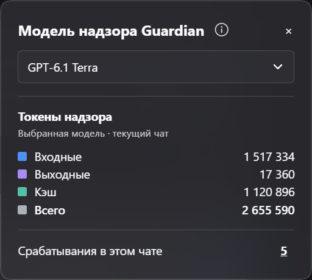
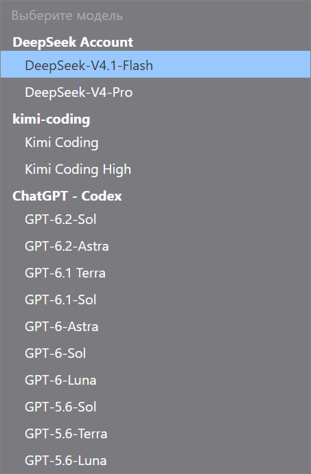
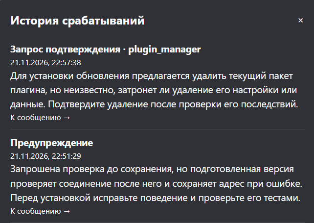
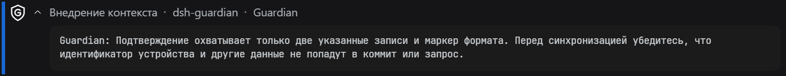
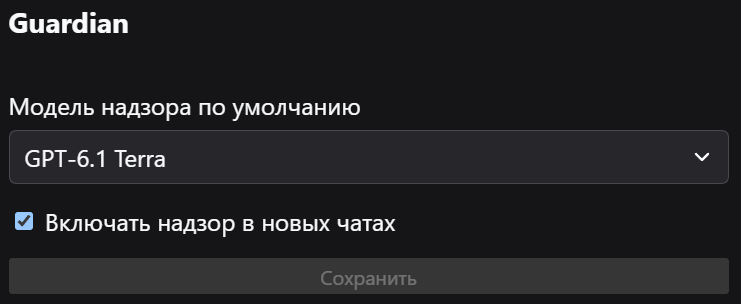

# Guardian в чате и настройках DSH

### 1. Панель щита

Нажмите **G** под полем ввода. Расход показан для выбранной модели и текущего чата; число срабатываний относится ко всем моделям надзора в этом чате.

### 2. Выбор модели

Выберите модель надзора из каталога доступных провайдеров DSH. Список ниже — пример, а не обязательный набор моделей.

### 3. История срабатываний

Нажмите число срабатываний. В списке видны причина вмешательства, время и, если запись связана с сообщением, переход в чат.

### 4. Отмеченное место в переписке

При переходе из истории Guardian раскрывает нужные свёрнутые блоки. Синяя полоса и щит **G** стоят рядом с выбранной записью.

### 5. Настройки для новых чатов

В карточке установленного плагина выберите модель по умолчанию, отметьте нужный режим и нажмите **Сохранить**. Значения не меняют уже созданные сессии.

